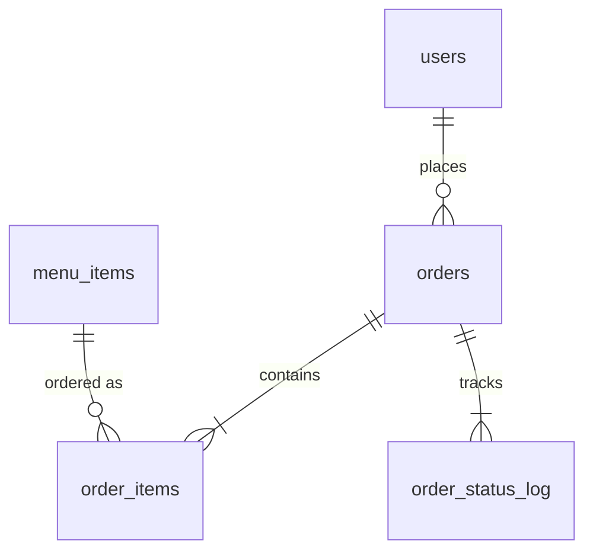

# CSPC Cafeteria Pre-Order System
*A web-based pre-ordering and pickup management system for the Camarines Sur Polytechnic Colleges cafeteria. Capstone project, Version 1.1.*

## 1. Overview
Students order meals ahead of time and choose a pickup window. Cafeteria staff manage preparation, claiming, inventory and sales reporting. The system reduces waiting lines and gives the cafeteria accurate demand and stock data.

## 2. Objectives
1. Let students browse the menu and pre-order meals online.
2. Control cafeteria workload through limited pickup-time slots (10 orders per 15-minute slot).
3. Give staff a preparation queue, inventory control and daily sales reports.
4. Protect accounts and data through secure authentication and server-side validation.

## 3. Users and Roles
| Role | Capabilities |
|---|---|
| Customer (Student, Employee, Instructor, Administrator) | Create their own account with a CSPC email, sign in with CSPC email + password, set up and edit their own profile (name, ID number, course/department/office, contact number), browse the menu, order, choose an **AM or PM** pickup time, track and cancel pending orders, show a QR pickup pass, change password |
| Cafeteria Staff | Dashboard, all orders, status updates, **QR scanner to verify and claim orders**, inventory and items, daily report (CSV), audit log |

Everyone registers on the same page and picks their type (Student, Employee, Instructor, Administrator or **Cafeteria Staff**). Choosing *Cafeteria Staff* asks for a **staff access code**. **The cafeteria staff decide this code**, not the developer: a signed-in staff member opens **Staff Console → Access Code**, types a new code (8 to 40 characters) and confirms with their own password. The code is stored only as a scrypt hash, so it cannot be viewed again (set a new one if it is forgotten). Staff can change it any time (the old code stops working immediately) or **close staff sign-up** by removing it. There is **no default code**: until staff set one, nobody can register as staff. Wrong codes are rate-limited, and every code change and staff registration is written to the audit log. A seeded staff account (`staff@cspc.edu.ph`) exists for the first setup. Optionally, `STAFF_CODE=...` can provide a one-time starting code on a fresh database.

## 4. System Flow
**Customer:** Register with CSPC email / Sign in → Dashboard → Menu → Food Details → Cart → Pickup-Time Selection (AM / PM) → Order Confirmation → Order Tracking → QR Pickup Pass.
**Staff:** Login → Dashboard → Orders → Preparation Queue (Pending → Preparing → Ready → Claimed) → Inventory → Reports → Audit Log.

## 5. Installation
Requires Node.js 22.13 or newer (SQLite is built in, so no extra database software or build tools are needed).
```
npm install
npm start       # http://localhost:3000
npm test        # automated API tests
```
Evaluation accounts: customer `juan.delacruz@cspc.edu.ph` / `Student@123`; staff `staff@cspc.edu.ph` / `Staff@123`. Change these before any real deployment.

**CSPC email rule:** only addresses ending in `@cspc.edu.ph` (or a subdomain such as `@student.cspc.edu.ph`) can register. To use a different domain: `EMAIL_DOMAIN=your.domain npm start`.

**Login background photos:** the left side of the sign-in/register page uses the real CSPC campus photo `public/img/login/bg-1.jpg`. To change it, replace that file (ideally 1600×1000 or larger, under 400 KB). Use photos you own or that are free to use (for example from Unsplash or Pexels, or your own campus photos). Any missing file falls back to the drawn illustration.

**Food photos (real images):** the menu now has 33 dishes (Main Dish 10, Snacks 8, Drinks 8, Dessert 7). Each dish points to `public/img/food/<name>.jpg`. Download real photos automatically (needs internet, run once on your computer):
```
npm run images            # fetches the missing photos from Wikimedia Commons (free licenses)
```
The script saves `public/img/food/CREDITS.md` with the author and license of every photo, so keep that file. Check every photo; if one is wrong, replace that file with your own photo of the same name (about 800x600). Any missing file falls back to a drawn plate. The extra 25 dishes are listed in `database/menu-add.json` and are added automatically on start (existing databases too, no duplicates).

**QR scanning:** the pickup pass QR (shown on the Order Tracking page and the QR Pass page) contains a *signed link* to this system, so **any phone Camera app can scan it**. When the cafeteria staff scan it, the system opens the staff scan page and shows the order, ready to claim (they sign in first if needed). A customer who scans their own QR is taken to their order tracking. The QR is signed, so edited or fake codes are rejected. Inside the staff *Scan QR* page, camera scanning needs Chrome/Edge on `https://` or `localhost`; other browsers can use the phone Camera app, type the code, or use a USB/Bluetooth scanner. **Important:** the QR contains the address you used to open the site, so open the system through the address phones can reach (your server's LAN IP such as `http://192.168.1.10:3000`, or your https domain), not `localhost`.

**Look:** pages use the same navy / blue / orange palette and campus photo as the login page.

## 6. Project Structure
```
server.js                   Express server, API routes, validation, security
database/schema.sql         Table definitions (SQLite)
database/seed.sql           Initial menu data
database/menu-add.json      25 additional dishes
scripts/fetch-food-images.js Downloads real food photos (npm run images)
database/db.js              Database connection and first-run setup
database/schema.mysql.sql   Reference schema for MySQL / MariaDB
public/                     Single-page application (index.html, css/, js/)
test/smoke.js               Automated API test suite
```
The database file `database/cafeteria.db` is created automatically on first run. Delete it to reset the system.

## 7. Database Design
Engine: SQLite (relational, foreign keys enforced). Passwords are stored only as scrypt hashes.

| Table | Purpose and key fields |
|---|---|
| users | id, name, id_number (unique), email (unique), role (customer/staff), user_type (student/employee/instructor/administrator/staff), department, contact, password_hash |
| menu_items | id, name, category, price, stock (>= 0), prep_minutes, description, ingredients, allergens, rating, image |
| orders | id, order_no (unique), order_date, user_id (FK), slot, total, status |
| order_items | order_id (FK), item_id (FK), name, unit_price, quantity (> 0). Prices are copied so past orders never change |
| order_status_log | order_id (FK), status, changed_at. Gives the tracking timestamps |
| audit_log | created_at, user_ref, role, action, detail |
| settings | key, value. Holds the session-signing secret |

Order statuses: `pending → preparing → ready → claimed`, or `pending → cancelled`.
To use MySQL/XAMPP instead, import `database/schema.mysql.sql` in phpMyAdmin and replace the queries in `server.js` with a MySQL driver.

## 8. Main API Endpoints
`POST /api/register, /login, /logout, /password` · `PATCH /api/profile` · `GET /api/me, /menu, /slots` · `POST /api/scan` (staff) · `POST /api/orders` · `GET /api/orders[/:no]` · `PATCH /api/orders/:no/status` (staff) · `PATCH /api/orders/:no/cancel` (customer) · `PATCH|POST /api/menu` (staff) · `GET /api/reports/daily, /audit` (staff) · `GET|PUT|DELETE /api/staff/access-code` (staff) · `GET /api/register-info`

## 9. Security Measures
Password hashing (scrypt, per-user salt) · HMAC-signed HttpOnly SameSite=Strict session cookie · role checks on every protected route · server-side recalculation of prices, stock and slot capacity · login rate limiting · input validation · XSS-safe output encoding · JSON-only mutations (CSRF defence) · Content-Security-Policy and security headers · audit log of sensitive actions.

## 10. Limitations and Future Work
SQLite suits a single cafeteria server; move to MySQL/PostgreSQL for many concurrent users · HTTPS must be enabled by the host · email verification (OTP) / password reset by email, notifications and online payment are not included. Without email verification the system only checks that the address *ends* in the CSPC domain, not that the person owns it.

**Fixing a wrong food photo:** run `npm run images` to download any missing photos. Dishes that had a wrong photo (Halo-Halo, Turon, Bottled Water) now use the dish's Wikipedia lead photo or a filtered search, and empty or invalid downloads are rejected. Halo-Halo, Turon and Bottled Water now ship with rendered images; Missing photos still fall back to a neutral "Photo coming soon" plate. To use your own photo, save it as `public/img/food/<name>.jpg` (for example `halo-halo.jpg`); existing files are never overwritten unless you run `npm run images -- --force`.


## Menu photos (staff)
In **Inventory**, the *Add Item* form has a photo picker. Pick a real photo of the food or drink (take it with the phone camera or choose a file); it is shrunk in the browser and saved on the server. Use the file picker in the *Photo* column to change the photo of an existing item. Photos are stored in `database/uploads/` (or in an `uploads` folder next to `DB_FILE`; set `UPLOAD_DIR` to override). If an item has the same name as a stock photo in `public/img/food/` (for example `Chicken Adobo`), that photo is used automatically.

If you add an item **without** a photo, the server looks for a real, free-licensed photo of it on Wikimedia Commons (needs internet on the server). The result is a best guess, so check it and replace it with your own photo if it is wrong. Items without a photo also get a **Find photo** button in Inventory. Credits of auto-found photos are written to `database/uploads/CREDITS.md`.

**Delete item:** each row in Inventory has a *Delete* button. The item disappears from the customer menu and cannot be ordered, but it is only hidden (not erased) so past orders and the daily report stay correct.

**Live delete:** when staff delete an item in Inventory it is hidden from every customer within about 5 seconds (no refresh needed) and is removed from their carts. An order that still contains a deleted item is rejected with a clear message.

**Profile after sign-in:** signing in with a CSPC email opens *that account's own* profile (name, CSPC email, ID number, course/department, contact, member-since date and order counts). The name and email in the top bar link to the profile at any time; staff have a Profile page too. Carts are kept per account.

**Profile photo:** every account (customer and staff) can add, change or remove its own profile photo on the Profile page. The photo is shrunk in the browser, checked by its real file type on the server and shown on the Profile page and in the top bar. Without a photo, the initials are shown. Real photos from the school Google/Microsoft account need an "Sign in with CSPC account" setup (client ID from the school) and are not included.

## Sign in with Google (CSPC school account)

A **Continue with Google** button appears on the **Create Account** page and a **Sign in with Google** button on the Sign In page when the server has a Google client ID. After the customer signs in with their `@my.cspc.edu.ph` Google account, the system creates or opens their account and fills in the **name, email and profile photo from Google automatically**. First-time Google users only add their ID number, course/department and contact number on the Profile page. New accounts made this way are always customers (staff accounts still need the staff access code). Existing accounts with the same email are reused.

**One-time setup (free):**
1. Open https://console.cloud.google.com and create a project (any name).
2. *APIs & Services → OAuth consent screen*: choose **External**, fill in the app name (CSPC Cafeteria Pre-Order) and your email. Under *Audience* click **Publish app** so every CSPC account can sign in (only the basic email/profile scopes are used, so no review is needed). If the school's Google admin makes it **Internal**, only CSPC accounts can sign in.
3. *APIs & Services → Credentials → Create credentials → OAuth client ID → Web application*. Under **Authorized JavaScript origins** add `http://localhost:3000` (and your real https address when you deploy). Copy the **Client ID**.
4. Start the server with the client ID:
   - Windows PowerShell: `$env:GOOGLE_CLIENT_ID="your-id.apps.googleusercontent.com"; npm start`
   - Windows CMD: `set GOOGLE_CLIENT_ID=your-id.apps.googleusercontent.com&& npm start`
   - Mac/Linux: `GOOGLE_CLIENT_ID=your-id.apps.googleusercontent.com npm start`

Notes: Google accepts only `localhost` or an https domain as origin, so open the site through `http://localhost:3000` on the computer, or deploy it on an https domain for phones. The server needs internet to check the sign-in with Google. Without `GOOGLE_CLIENT_ID` the button is hidden and normal email + password login keeps working.

**Recommended flow for customers:** on *Create Account* press the Google button once and pick the CSPC account. The name, CSPC email and photo are filled in from Google, then the customer adds the ID number, contact and **creates a password** on the Profile page. From then on they sign in with the **CSPC email + password** and the profile and photo are already there (the photo is stored on the server), so no Google step is needed again. Accounts made the old way (form + password) get their Google photo the first time they press the Google button.

## Using the system on a phone

1. **Same Wi-Fi (quickest test).** Run `npm start`. The terminal prints a line such as `On a phone on the same Wi-Fi: http://192.168.1.10:3000`. Open that address on the phone. If it does not open, allow Node.js through the Windows Firewall (private network).
   Limits of plain `http://`: browsers block the phone **camera** (QR scanning), **browser notifications** and Google sign-in on it. Ordering, tracking, the QR pass and manual order-number entry still work.
2. **Public HTTPS link (everything works, including camera and Google sign-in).** Start the system, then in a second terminal run a tunnel:
   - Cloudflare Quick Tunnel (no account): `cloudflared tunnel --url http://localhost:3000` prints a `https://….trycloudflare.com` link. The link changes every time and is meant for testing/demos.
   - ngrok (free account): `ngrok http 3000` gives a `https://….ngrok-free.app` link.
   Start the server with `TRUST_PROXY=1` (PowerShell: `$env:TRUST_PROXY=1; npm start`) so the login limit sees each visitor's real address. For Google sign-in, add the https link to **Authorised JavaScript origins** in Google Cloud.
3. **Always-on hosting.** Use a host that gives Node.js 22.13+ and a disk that is kept between restarts (the database is the file `cafeteria.db`), or a server of the school.

